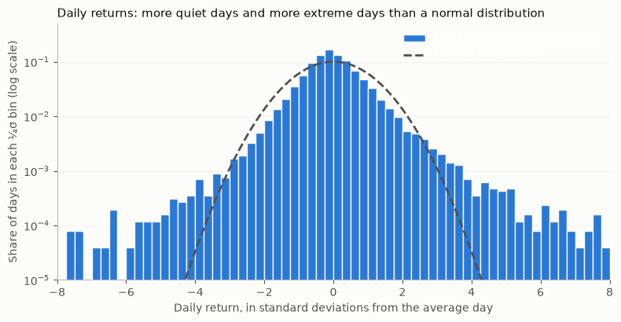
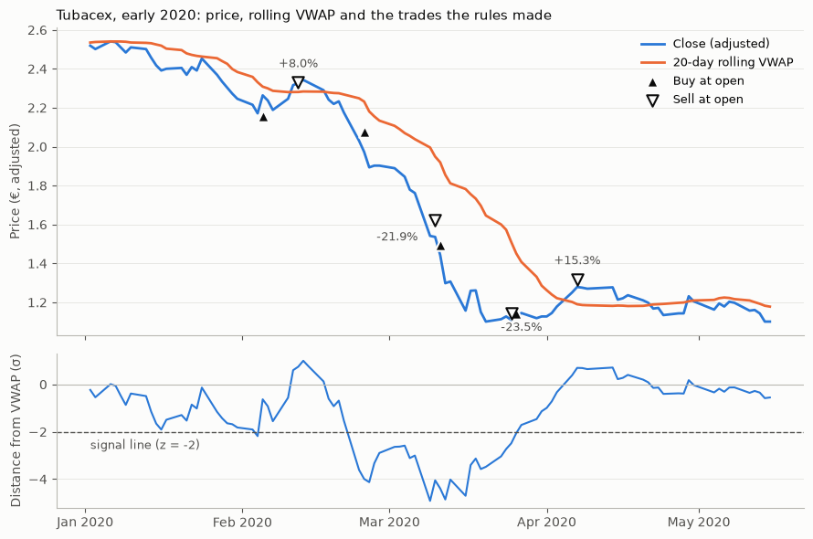
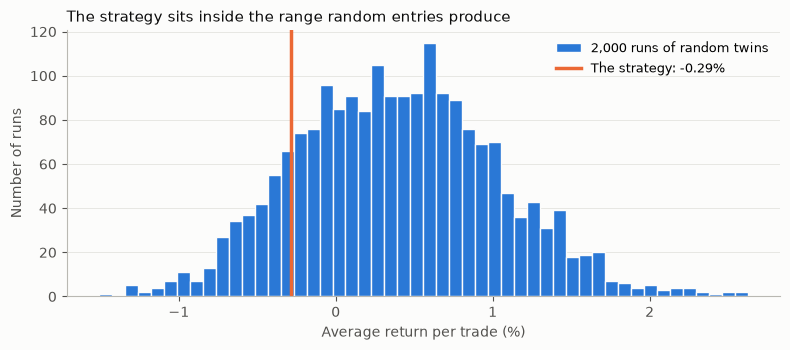
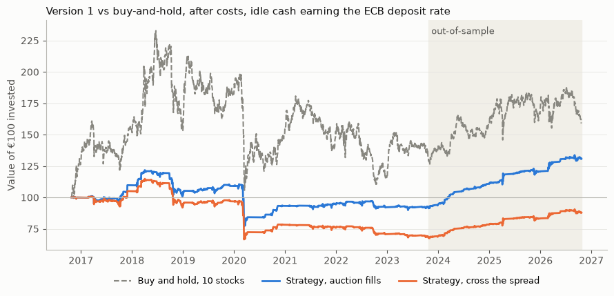
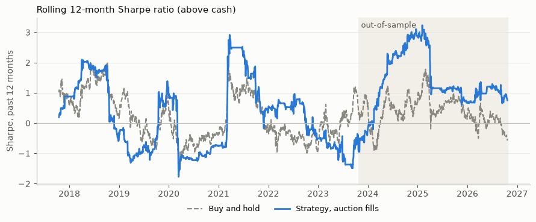

# Buying 2σ dips below a rolling VWAP in Spanish small caps

*[Your name] · BSc Mathematics & Computing (1st year), Universidad Carlos III de Madrid · October 2026*

> **Summary.** I tested a simple mean-reversion rule on 10 liquid Spanish stocks that sit below the €1bn transaction-tax threshold: **buy when the price falls 2 standard deviations below its 20-day rolling VWAP, sell when it gets back to the VWAP or after 10 trading days.** The rules, the cost model and a pass/fail criterion were all fixed before a single run on the held-out years (Oct 2023 – Oct 2026).
>
> The strategy **passed** that test: +2.83% per trade after commission (t = 3.9), and a Sharpe ratio of 1.36 against 0.38 for buy-and-hold. But over the full decade it averaged only +0.67% per trade before costs (t ≈ 0.8), with a Sharpe ratio of 0.24 against buy-and-hold's 0.27. It makes money when sell-offs reverse quickly and loses when they drag on, and the held-out years happened to be the former. **Conclusion: this data can't show an edge that holds across market conditions.**

**Video:** [a 100-second animated summary](video/vwap_dip_explainer.mp4), made with Manim ([narration script](video/narration.md)).

## Key findings

- **The pre-registered out-of-sample test passed**, and the result survives the obvious checks: it isn't a data error, it's still +2% per trade without the five best trades, and it's positive in all 10 stocks.
- **The results depend on the market regime.** Average trade by year ranges from −3.6% (2020) to +4.0% (2024). No 3-year stretch of the in-sample period came close to the held-out years.
- **The question needs far more data than 10 stocks provide.** With trade returns this volatile, telling a 0.5% edge apart from luck would take about 1,700 trades: **54 years** at this strategy's pace.
- **The data needed fixing.** Yahoo Finance missed a 4-for-1 split, which would have been the largest "dip" in the dataset, and the backtest would have bought it.
- **Trading costs are the biggest unknown:** from 0.10% to about 1.4% per round trip, depending on whether orders fill in the opening auction or cross the bid-ask spread.

---

## 1. The question

Every trade has someone on the other side. When a stock falls far below the price where most of its recent volume traded, the seller is either **in a hurry** (a fund cutting a position, a margin call), in which case the price should bounce back, or **better informed** (a profit warning), in which case it shouldn't. Buying the dip is a bet that the first kind is more common.

The volume-weighted average price (VWAP) is a natural "fair value" anchor, since it's the price at which the volume actually traded. And because Spain taxes purchases of large companies, the test focuses on stocks that avoid that tax.

## 2. Universe: 10 stocks, chosen by a rule written in advance

Picking the stocks after seeing which ones "work" would measure luck, not edge. So the universe follows from these rules, applied as of the close on 23 Oct 2026 ([notebook 01](notebooks/01_universe_selection.ipynb)):

1. Listed on BME's main market (Mercado Continuo) and not suspended: 123 stocks.
2. A Spanish company.
3. **Market cap below €1bn and not on the 2026 transaction-tax list.** Spain charges 0.2% on purchases of Spanish companies worth more than €1bn on the previous 1 December, which is big next to the edge a strategy like this could have. Both checks are needed: Aedas Homes is worth €937m today but was above €1bn on 1 Dec 2025.
4. At least 10 years of daily prices, so every stock covers the whole backtest.
5. Not under a takeover bid, in insolvency or in a court restructuring.
6. Of what's left, the 10 with the highest **median** daily euros traded over the previous 12 months. The median rather than the mean, because a few huge days inflate the mean.

| Stock | Ticker | Market cap | Median € traded per day |
|---|---|---:|---:|
| OHLA | OHLA.MC | €456m | €2.77m |
| eDreams ODIGEO | EDR.MC | €473m | €2.31m |
| Amper | AMP.MC | €440m | €1.36m |
| Oryzon Genomics | ORY.MC | €205m | €0.91m |
| Tubacex | TUB.MC | €338m | €0.87m |
| Ence | ENC.MC | €534m | €0.71m |
| Nextil | NXT.MC | €436m | €0.69m |
| Global Dominion | DOM.MC | €385m | €0.68m |
| Grupo San José | GSJ.MC | €448m | €0.41m |
| Audax Renovables | ADX.MC | €457m | €0.30m |

Three stocks that ranked high on liquidity were excluded: TSK (listed in May 2026), Prosegur Cash (listed in March 2017) and Soltec (suspended from September 2024 to December 2025 during a court restructuring).

## 3. Data and cleaning

Daily open, high, low, close and volume from Yahoo Finance (`yfinance`), January 2016 to 23 Oct 2026. Every problem found was fixed in code, with the reason recorded; raw downloads are never edited ([notebook 02](notebooks/02_universe_data.ipynb)).

| Problem | Effect if left in | Fix |
|---|---|---|
| **Nextil's 4-for-1 split on 3 Aug 2018 was never applied by Yahoo** | a −73% overnight "crash", the largest dip in the dataset | divide earlier prices by 4, multiply earlier volume by 4 |
| A trading row on 25 Dec 2019, when the exchange was closed | a fake flat day | drop zero-volume days |
| 7 bars with the high below the close, or the low above the open | wrong typical price, which feeds the VWAP | set high/low to the max/min of open, high, low, close |
| Amper's 25-to-1 reverse split (Jul 2026) | none: Yahoo adjusted it correctly | checked, no change |

**What daily returns look like.** These stocks are volatile: 27% to 59% a year, 45% on average. Their returns are far from normal. 80% of days fall within ±1σ (68% for a normal distribution), and a −3σ day happens 0.49% of the time instead of 0.13%. Fat tails mean more quiet days and more extreme days, with fewer in between.



Volatility also comes in clusters. With one σ for the whole decade, 2020 alone produces 110 of the −2σ days and 2024 only 13. Measuring each day against **the σ of the previous 60 days** evens this out to 40–73 a year, and brings the share of −2σ days to 2.24%, close to the normal distribution's 2.28%. The signal uses this local, past-only yardstick.

## 4. The strategy (version 1, frozen before seeing results)

Daily bars contain no individual trades, so each day's average trade price is approximated by the typical price, and all prices are dividend-adjusted (an ex-dividend drop would otherwise look like a dip):

$$\text{VWAP}_t = \frac{\sum_{i=t-19}^{t} \tfrac{H_i + L_i + C_i}{3}\, V_i}{\sum_{i=t-19}^{t} V_i}, \qquad d_t = \frac{C_t}{\text{VWAP}_t} - 1, \qquad z_t = \frac{d_t}{\sigma_{60}(d)_{\,t-1}}$$

where $\sigma_{60}(d)_{t-1}$ is the standard deviation of $d$ over the 60 days *before* day $t$.

| Piece | Rule |
|---|---|
| Signal | $z_t \le -2$ at the close |
| Entry | next day's open |
| Exit | next open after the close gets back to the VWAP, or after 10 trading days |
| Positions | at most one per stock |

Every input to a decision is known at the close, and every order fills at the next open. The data is split once: **in-sample** 24 Oct 2016 – 23 Oct 2023 (7 years), and **out-of-sample** 24 Oct 2023 – 23 Oct 2026 (3 years), left untouched until the final test. Code: [`src/vwap_dip.py`](src/vwap_dip.py), walk-through in [notebook 03](notebooks/03_signal_and_backtest.ipynb).



## 5. Costs

Assumed account: €100,000 split into 10 slots of €10,000, one per stock ([notebook 04](notebooks/04_costs.ipynb), [`src/costs.py`](src/costs.py)).

| Cost | Value used | How |
|---|---|---|
| Commission | 0.05% per order, €3 minimum | Interactive Brokers' fixed pricing for Spain |
| Transaction tax | **0 for every trade** | the tax agency's lists for 2021–2026 were checked: none of the 10 stocks is on any of them |
| Bid-ask spread | estimated at **0.8%–2.4%** by stock | EDGE estimator (Ardia, Guidotti & Kroencke, 2024) over the previous 252 days |

**How the spread estimate was chosen.** Daily bars don't record bids or asks, so the spread has to be estimated. I tested two published estimators by simulating a market with a *known* spread. The simpler Abdi-Ranaldo (2017) estimator is right on average but returned 0 in 45% of simulated years when the true spread was 0.3%. EDGE stayed within about ±0.2 points (10th–90th percentile), so that's the one used.

**Do we even pay the spread?** BME opens with an auction, and an order in the auction gets the auction price without crossing a spread. So every result is reported under two scenarios: **auction fills** (commission only, 0.10% per round trip) and **crossing the spread** (commission plus half the spread each way, about 1.4% per round trip on average). The truth is probably in between.

## 6. In-sample results (2016–2023)

| | |
|---|---:|
| Trades | 225 |
| Win rate | 52% |
| Average win / average loss | +7.43% / −8.64% |
| EV per trade, before costs | −0.29% |
| EV, auction fills / crossing the spread | −0.39% / −1.73% |

A 52% win rate with a negative EV: trades that got back to the VWAP made +8.9% on average (87 trades), while those stopped out after 10 days lost −6.1% (138 trades).

**Better than chance?** I gave every trade a *random twin*: the same stock and holding period, but entered on a random day. Averaging all 225 twins and repeating 2,000 times shows how much an average wobbles by chance alone. **85% of the random runs did at least as well as the strategy.**



**The reason for expecting dips to revert wasn't supported.** Dips that hit 3 or more of the 10 stocks on the same day (market-wide) averaged −0.82% per trade, against +0.10% for stock-specific dips. That's the opposite of the hypothesis, though well within chance at about 100 trades per group.

## 7. The final out-of-sample test (2023–2026)

The pass/fail rule, written before the run: **version 1 has an edge only if the out-of-sample EV after auction-fill costs is positive and at least 2 standard errors above zero**, with trades grouped by calendar month so that trades from the same sell-off count as one cluster. The code was debugged on in-sample data first, and the out-of-sample years were run once ([notebook 05](notebooks/05_final_test.ipynb)).

| | In-sample 2016–2023 | **Out-of-sample 2023–2026** |
|---|---:|---:|
| Trades | 225 | 95 |
| Win rate | 52% | 68% |
| EV before costs | −0.29% | +2.94% |
| EV, auction fills | −0.39% | **+2.83%** |
| EV, crossing the spread | −1.73% | +1.77% |
| t-statistic, auction fills (grouped by month) | −0.35 | **3.94** |
| Random-entry runs at least as good | 85% | 0% |

**It passes.** The standard error comes from the same √n logic as annual volatility: if each trade has standard deviation σ, an average of n trades has standard deviation σ/√n.

## 8. As a portfolio: returns and Sharpe ratios

Each slot holds its stock during a trade and otherwise earns the ECB deposit rate. The Sharpe ratio is measured on returns **above** that cash rate. The strategy is in a trade only 11% of the time, and the benchmark is buy-and-hold: €10,000 in each stock at the start of the period, never touched.

| Period | Portfolio | Annual return | Volatility | **Sharpe** | Max drawdown |
|---|---|---:|---:|---:|---:|
| In-sample | Strategy, auction fills | −1.2% | 10.3% | **−0.07** | −36.8% |
| | Strategy, crossing the spread | −5.3% | 10.3% | −0.48 | −42.1% |
| | Buy and hold | 3.9% | 28.4% | 0.27 | −54.6% |
| Out-of-sample | Strategy, auction fills | 12.5% | 6.8% | **1.36** | −4.0% |
| | Strategy, crossing the spread | 9.0% | 6.7% | 0.90 | −4.2% |
| | Buy and hold | 8.8% | 20.2% | 0.38 | −21.0% |
| Full decade | Strategy, auction fills | 2.7% | 9.4% | **0.24** | −36.8% |
| | Strategy, crossing the spread | −1.3% | 9.4% | −0.18 | −42.1% |
| | Buy and hold | 4.7% | 26.0% | 0.27 | −54.6% |



**How precise is a Sharpe ratio?** Its uncertainty comes mainly from the average return, so the same √n argument applies, with *years* as the unit: **SE(Sharpe) ≈ 1/√years** (Lo, 2002 gives the full version). Only calendar time matters, not the number of trades. Three years give ±0.58, so the out-of-sample 1.36 has a ±2 SE range of 0.21 to 2.50. Reshuffling whole months gives a narrower 0.81 to 2.20, but reshuffling 2023–26 months can only rebuild 2023–26-style markets. Over the decade, every range for both the strategy and buy-and-hold includes zero.



## 9. Is the out-of-sample result real?

A result that flips sign from in-sample to out-of-sample needs checking before anyone believes it. These checks were added *after* the run and change nothing about the rules or the verdict; they only help interpret it.

- **Data error?** No. A missed reverse split would show a one-day jump of several hundred percent. The biggest out-of-sample one-day rise is +24% (Oryzon).
- **A few lucky trades?** No. Without the five best trades the EV is still +1.98%, and it's positive in all 10 stocks (+0.7% to +6.9%).
- **Does it depend on the market?** Yes, strongly:

| Entry year | 2017 | 2018 | 2019 | 2020 | 2021 | 2022 | 2023 | 2024 | 2025 | 2026* |
|---|---:|---:|---:|---:|---:|---:|---:|---:|---:|---:|
| EV per trade, before costs | +2.6% | −0.9% | +1.6% | −3.6% | +0.9% | −1.1% | +0.1% | +4.0% | +2.1% | +2.5% |
| Sharpe, auction fills | 0.87 | −0.56 | 1.34 | −0.74 | 0.34 | −0.35 | −0.33 | 2.99 | 0.76 | 1.15 |

<sub>*2026 runs to 23 October. 2023 combines in-sample and out-of-sample trades.</sub>

  The strategy loses in years when sell-offs drag on (2018, 2020, 2022) and wins when they reverse quickly. In 2023–2026, even the April 2025 crash reversed within days. No 3-year stretch of the in-sample period did better than +0.97% per trade, against +2.94% out-of-sample.
- **The whole decade together:** 320 trades, EV +0.67% before costs. That's t = 0.78 grouped by month, or 0.95 grouped by year. It can't be told apart from luck.

**The pass/fail rule had a blind spot.** Grouping trades by month handles trades that bunch up in the same sell-off. It doesn't handle whole *years* that go well or badly together. Three held-out years are really just three draws of "what kind of market was it".

**How much data would settle it?** To show an edge *e* at t = 2, you need n ≥ (2σ/e)² trades. With σ = 10.4% per trade and 32 trades a year:

| True edge per trade | 0.25% | 0.5% | 1% | 2% |
|---|---:|---:|---:|---:|
| Trades needed | 6,888 | 1,722 | 430 | 108 |
| Years at this pace | 215 | 54 | 13 | 3 |

## 10. Conclusion

Buying 2σ dips below a 20-day rolling VWAP in liquid Spanish small caps was profitable from October 2023 to October 2026 after realistic costs, and it passed a test specified in advance. Over ten years, though, its returns depend on whether sell-offs reverse quickly, and its risk-adjusted return (Sharpe 0.24) is no better than holding the same stocks (0.27). **This data can't show an edge that holds across market conditions**, and a realistic edge couldn't be detected with 10 stocks and daily bars anyway. Going further needs many more independent observations, not more tuning of this rule.

## 11. Limitations

- **Survivorship bias.** Stocks were chosen by today's size and status, but tested on the last 10 years. Free data has no historical lists of which stocks were small at the time.
- **Volume is Madrid-only.** Yahoo reports trading on BME only, but some trading in these stocks happens on other European venues. That's fine for ranking stocks, not for measuring total liquidity.
- **Spread estimates are estimates.** They're validated on simulated data, not against real quotes. Market impact isn't modelled: €10,000 is up to about 3% of a typical day's trading in the quietest stock.
- **The commission rate comes from a third-party review.** Interactive Brokers' own pricing page couldn't be fetched automatically.
- **A small, fixed universe**, which limits statistical power (Section 9).

## 12. What I'd do next

1. **More independent observations:** apply the same frozen rules to small caps in other European markets, before looking at any results.
2. **Make the regime explanation a testable hypothesis:** write down in advance a measurable definition of "sell-offs that reverse quickly" and test it on new data. Choosing it from these results would be data snooping.
3. **Intraday data** for a true session VWAP, which is closer to the original idea, and gives many more signals per year.
4. **Paper-trade the frozen rules**, which adds genuinely new out-of-sample data every month.

## Reproducing this

```bash
python -m venv .venv
.venv/Scripts/pip install -r requirements.txt
.venv/Scripts/jupyter-lab
```

Run the notebooks in order:

| Notebook | What it does |
|---|---|
| [01_universe_selection](notebooks/01_universe_selection.ipynb) | applies the selection rule and saves `data/universe/universe_v1.csv` |
| [02_universe_data](notebooks/02_universe_data.ipynb) | downloads prices, runs quality checks and fixes, analyses returns |
| [03_signal_and_backtest](notebooks/03_signal_and_backtest.ipynb) | builds the signal and runs the in-sample backtest |
| [04_costs](notebooks/04_costs.ipynb) | builds and validates the cost model |
| [05_final_test](notebooks/05_final_test.ipynb) | runs the out-of-sample test, the significance checks, the Sharpe ratios and the robustness checks |

To rebuild the video, export its data with the research environment, then render it in a separate environment with Manim:

```bash
.venv/Scripts/python.exe video/prepare_data.py
python -m venv .venv-video
.venv-video/Scripts/pip install -r video/requirements.txt
.venv-video/Scripts/manim.exe -r 1920,1080 --fps 30 --media_dir video/media video/explainer.py Explainer
```

Market caps are saved as a snapshot (`data/universe/`), so the stock selection reproduces exactly. Prices are re-downloaded from Yahoo on a fresh clone and may differ slightly if Yahoo revises its history. Reference lists and their sources are in [`data/reference/SOURCES.md`](data/reference/SOURCES.md).

```
├── notebooks/        01-05, run in order
├── src/
│   ├── vwap_dip.py   signal and trade simulation
│   └── costs.py      commission, spread estimate, transaction tax
├── data/
│   ├── reference/    BME main-market list, tax lists, sources
│   ├── universe/     selection snapshot and the final 10
│   └── results/      trade lists, in-sample and out-of-sample
├── figures/          charts used in this README
└── video/            explainer video, its Manim source and narration script
```

## References

- Abdi, F. & Ranaldo, A. (2017). A simple estimation of bid-ask spreads from daily close, high, and low prices. *Review of Financial Studies*, 30(12), 4437–4480.
- Ardia, D., Guidotti, E. & Kroencke, T. A. (2024). Efficient estimation of bid-ask spreads from open, high, low, and close prices. *Journal of Financial Economics*, 161, 103916.
- Lo, A. W. (2002). The statistics of Sharpe ratios. *Financial Analysts Journal*, 58(4), 36–52.
- Data: BME (main-market list), Agencia Tributaria (transaction-tax lists), European Central Bank (deposit facility rate), Yahoo Finance via `yfinance` (prices).

*Research project, not investment advice.*
